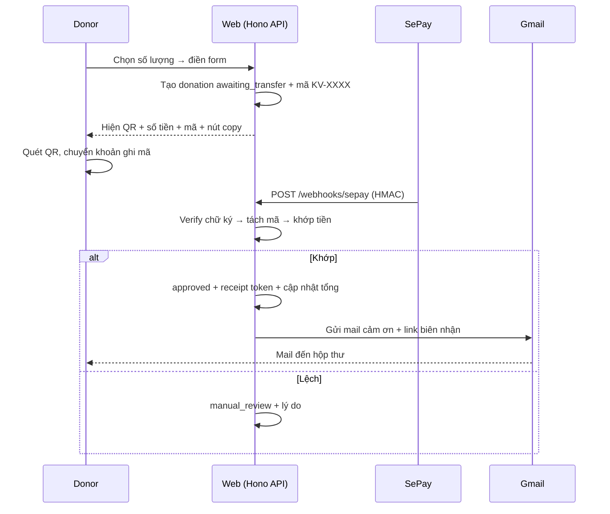

# SOFTWARE REQUIREMENTS SPECIFICATION (SRS)
## Website Kết Vòng - Luồng quyên góp tự động qua SePay

**Status:** Draft | **Owner:** Bùi Anh Huy | **Phiên bản:** 2.0 (2026-10-10)
**Thay thế:** v1.0 (2026-10-09, luồng thủ công) - bị thay bằng quyết định chuyển sang tự động ngày 2026-10-10.
**Format:** theo skill `common-software-requirements` (requirement card `SRS-*`, traceability, verification matrix). Chuẩn tham chiếu: ISO/IEC/IEEE 29148.

---

## 1. CONTEXT AND TRACE SOURCE

- **BRD-OBJ-01:** Quyên góp minh bạch cho workshop Kết Vòng (mục tiêu 2.300.000đ).
- **BRD-OBJ-02:** Tự động hóa ghi nhận ủng hộ, giảm sức người, giảm sai sót đối chiếu tay.
- **BRD-OBJ-03:** Tuân thủ NĐ 93/2021/NĐ-CP (vận động từ thiện) và NĐ 13/2023/NĐ-CP (dữ liệu cá nhân).
- **Scope:** Web chạy localhost để phát triển; kiến trúc phải migrate được lên Cloudflare (Pages + Workers + D1) mà không sửa business logic.
- **Ngoài phạm vi:** deploy production, MoMo/ZaloPay merchant gateway, tài khoản donor, đa chiến dịch, đa ngôn ngữ.

### REQ - yêu cầu đã chốt với product owner

| REQ ID | Nội dung |
|---|---|
| REQ-01 | Donor không cần đăng nhập trong toàn bộ luồng |
| REQ-02 | Chọn số lượng theo preset + nhập tùy ý; mỗi mức hiện số tiền tương ứng; đơn giá và preset cấu hình qua UI |
| REQ-03 | Ảnh QR cấu hình qua UI, không hardcode |
| REQ-04 | SePay webhook tự động ghi nhận khi tiền vào tài khoản ngân hàng riêng của quỹ |
| REQ-05 | Mã ủng hộ (`KV-XXXX`) gắn với số tiền; donor ghi mã vào nội dung chuyển khoản để hệ thống khớp |
| REQ-06 | Log minh bạch công khai: tên (hoặc "Ẩn danh") + số tiền + thời gian; không SĐT/email |
| REQ-07 | Mail cảm ơn tự động qua Gmail cá nhân (OAuth2) sau khi ghi nhận |
| REQ-08 | Thư cảm ơn tải về từ web; 1 template + biến động; QR đắp bằng code (cấm AI gen ảnh) |
| REQ-09 | Ca lệch (sai/thiếu mã, sai số tiền) vào hàng chờ admin xử tay |
| REQ-10 | 3 admin: Huy (super-admin), Trúc + Hưng (admin) |
| REQ-11 | Báo cáo thu/chi đăng hàng ngày |
| REQ-12 | Consent xử lý dữ liệu rõ ràng, checkbox không tick sẵn (NĐ 13/2023) |
| REQ-13 | Backend Hono + SQLite qua lớp adapter để migrate Workers + D1 |

---

## 2. REQUIREMENT TRACE

| BRD Objective | PRD Req | AC | SRS | Verification |
|---|---|---|---|---|
| BRD-OBJ-01 | REQ-01, REQ-02, REQ-05 | AC-01 | SRS-001 - SRS-004 | E2E / manual |
| BRD-OBJ-02 | REQ-04, REQ-05, REQ-09 | AC-02 | SRS-010 - SRS-013, SRS-020 | integration / E2E |
| BRD-OBJ-01 | REQ-06 | AC-03 | SRS-030, SRS-031 | E2E / security test |
| BRD-OBJ-01 | REQ-01, REQ-07, REQ-08 | AC-04 | SRS-040, SRS-041, SRS-050 | E2E / manual |
| BRD-OBJ-01 | REQ-10, REQ-11 | AC-05 | SRS-060 - SRS-064 | E2E / review |
| BRD-OBJ-03 | REQ-12 | AC-06 | SRS-002, SRS-070 | E2E |
| BRD-OBJ-02 | REQ-13 | AC-07 | SRS-080 | review / build |

**AC (tiêu chí nghiệm thu):**
- AC-01: Đi hết luồng donor trên localhost: chọn số lượng → thấy đúng số tiền → điền form → nhận mã → màn hình chuyển khoản hiện đúng QR/số tiền/mã.
- AC-02: Giả lập webhook SePay (đúng chữ ký): mã + tiền khớp → tự động lên log và gửi mail; sai mã/sai tiền → vào hàng chờ; gửi trùng webhook → không ghi trùng.
- AC-03: API public không trả SĐT/email/nội dung chuyển khoản trong mọi response (kiểm tra JSON thô).
- AC-04: Sau khi duyệt (tự động hoặc tay): donor nhận mail trong 5 phút, mở link biên nhận không cần đăng nhập, tải thư PNG đúng tên/số tiền, QR trên thư quét được.
- AC-05: Admin đăng nhập, xử lý ca lệch, đăng báo cáo hàng ngày, đổi QR/đơn giá/template qua UI có hiệu lực ngay.
- AC-06: Submit thiếu consent bị từ chối; donor yêu cầu xóa dữ liệu được xử lý.
- AC-07: `pnpm build` pass; không có API chỉ-chạy-trên-Node trong request handler (review code).

---

## 3. REQUIREMENT CARDS

### 3.1 Chọn số lượng và cấp mã (donor)

#### SRS-001: Chọn số lượng ủng hộ
- **Statement:** Hệ thống phải cho donor chọn số lượng theo các mức preset do admin cấu hình (mặc định: preset duy nhất **1**), đồng thời cho phép nhập số lượng tùy ý là số nguyên dương.
- **Priority:** Must | **Status:** Draft | **Source:** REQ-02, AC-01
- **Input / Trigger:** click preset hoặc nhập số vào ô tùy chỉnh.
- **Processing Rule:** số tiền = số lượng × đơn giá; đơn giá mặc định **10.000đ**/vòng tay, đọc từ settings (admin đổi được qua UI, không hardcode).
- **Output:** số tiền tương ứng hiển thị ngay dưới lựa chọn, cập nhật realtime khi đổi số lượng.
- **Error / Fallback:** số lượng ≤ 0, không phải số nguyên, hoặc vượt hạn mức cấu hình → báo lỗi cạnh trường, chặn nút tiếp tục.
- **NFR Impact:** NFR-02 | **Measurement Method:** manual test | **Verification Lane:** E2E

#### SRS-002: Form thông tin ủng hộ
- **Statement:** Hệ thống phải thu thập thông tin donor qua form với validate đầy đủ phía server trước khi cấp mã.
- **Priority:** Must | **Status:** Draft | **Source:** REQ-01, REQ-12, AC-01, AC-06
- **Input / Trigger:** tên hiển thị (bắt buộc), xưng hô (Cô/Chú/Anh/Chị), email (bắt buộc, đúng format), SĐT (không bắt buộc, ghi chú chỉ dùng khi cần đối chiếu), lời nhắn công khai (không bắt buộc), checkbox "Hiển thị tên trên trang minh bạch" (mặc định tick), checkbox consent xử lý dữ liệu (bắt buộc, mặc định KHÔNG tick).
- **Processing Rule:** validate tất cả phía server; rate limit 10 submit/giờ/IP.
- **Output:** tạo bản ghi donation trạng thái `awaiting_transfer` + mã `KV-XXXX` duy nhất gắn với số tiền đã chọn.
- **Error / Fallback:** thiếu trường bắt buộc hoặc thiếu consent → 400 với message tiếng Việt rõ ràng từng trường; SĐT/email không bao giờ xuất hiện trong response công khai.
- **NFR Impact:** NFR-02, NFR-07 | **Measurement Method:** test case + kiểm tra JSON response | **Verification Lane:** E2E

#### SRS-003: Màn hình hướng dẫn chuyển khoản
- **Statement:** Sau khi cấp mã, hệ thống phải hiển thị đầy đủ thông tin để donor chuyển khoản đúng trong một màn hình.
- **Priority:** Must | **Status:** Draft | **Source:** REQ-03, REQ-05, AC-01
- **Input / Trigger:** donation `awaiting_transfer` vừa tạo.
- **Processing Rule:** lấy QR + thông tin tài khoản từ settings.
- **Output:** ảnh QR (cấu hình qua UI), số tài khoản + ngân hàng + chủ tài khoản, số tiền cần chuyển (đúng số đã chọn), mã `KV-XXXX`, nút copy cho từng trường, dòng hướng dẫn "ghi đúng mã này vào nội dung chuyển khoản".
- **Error / Fallback:** không áp dụng.
- **NFR Impact:** none | **Measurement Method:** manual test | **Verification Lane:** E2E

#### SRS-004: Định dạng, duy nhất và hết hạn của mã
- **Statement:** Mã ủng hộ phải duy nhất, khó nhầm và tự hết hạn nếu donor không chuyển khoản.
- **Priority:** Must | **Status:** Draft | **Source:** REQ-05, AC-02
- **Input / Trigger:** tạo donation.
- **Processing Rule:** mã dạng `KV-` + 6 ký tự `[A-Z0-9]` (loại trừ `0/O`, `1/I` dễ nhầm); unique constraint trong DB; bản ghi `awaiting_transfer` quá 48 giờ không có webhook khớp → chuyển `expired`.
- **Output:** mã lưu cùng donation.
- **Error / Fallback:** webhook đến sau khi mã hết hạn → vào hàng chờ tay (lý do `expired_code`).
- **NFR Impact:** none | **Measurement Method:** unit test sinh mã + kiểm tra unique | **Verification Lane:** unit

### 3.2 Webhook SePay (ghi nhận tự động)

#### SRS-010: Endpoint nhận webhook
- **Statement:** Hệ thống phải có endpoint nhận webhook SePay, xác thực chữ ký trước mọi xử lý và trả lời đúng yêu cầu của SePay.
- **Priority:** Must | **Status:** Draft | **Source:** REQ-04, AC-02
- **Input / Trigger:** `POST /api/v1/webhooks/sepay` từ SePay (không yêu cầu auth user).
- **Processing Rule:** verify chữ ký HMAC-SHA256 bằng secret trong `.env` (không hardcode); sai chữ ký → 401 và ghi log cảnh báo, không xử lý tiếp.
- **Output:** HTTP 200 + body `{"success": true}` trong vòng 30 giây (SePay retry tối đa 7 lần nếu không nhận 200).
- **Error / Fallback:** payload không parse được → 400 + log; lỗi nội bộ → 500 (SePay sẽ retry).
- **NFR Impact:** NFR-01 | **Measurement Method:** đo thời gian response trên log; giả lập chữ ký sai | **Verification Lane:** integration

#### SRS-011: Chống ghi trùng (idempotency)
- **Statement:** Webhook bị gửi lặp (retry) không được tạo bản ghi trùng.
- **Priority:** Must | **Status:** Draft | **Source:** REQ-04, AC-02
- **Input / Trigger:** webhook có `sepay_transaction_id` đã xử lý trước đó.
- **Processing Rule:** `sepay_transaction_id` có unique constraint; trùng → trả 200 nhưng bỏ qua toàn bộ xử lý tiếp theo.
- **Output:** không thay đổi dữ liệu.
- **Error / Fallback:** không áp dụng.
- **NFR Impact:** NFR-04 | **Measurement Method:** gửi cùng payload 3 lần, đếm bản ghi | **Verification Lane:** integration

#### SRS-012: Khớp tự động mã và số tiền
- **Statement:** Hệ thống phải tự động khớp giao dịch webhook với donation đang chờ dựa trên mã trong nội dung chuyển khoản và số tiền.
- **Priority:** Must | **Status:** Draft | **Source:** REQ-04, REQ-05, AC-02
- **Input / Trigger:** webhook hợp lệ (đã qua SRS-010, SRS-011).
- **Processing Rule:** tách mã `KV-XXXX` từ nội dung chuyển khoản (regex, không phân biệt hoa/thường, bỏ khoảng trắng); tìm donation `awaiting_transfer` còn hạn có mã trùng. Nếu số tiền webhook **bằng tuyệt đối** số tiền donation (VND) → chuyển `approved`, set `approved_at`, sinh receipt token, trigger mail cảm ơn (SRS-050), cập nhật tổng quỹ. Nếu mã đúng nhưng tiền lệch → `manual_review` (lý do `amount_mismatch`). Nếu không tách được mã → `manual_review` (lý do `missing_code`).
- **Output:** donation `approved` + bản ghi log minh bạch + mail trong hàng đợi gửi.
- **Error / Fallback:** các ca không khớp rớt vào SRS-020, không bao giờ tự động public.
- **NFR Impact:** NFR-04 | **Measurement Method:** bộ case: khớp chuẩn, sai tiền, thiếu mã, mã hết hạn | **Verification Lane:** unit + integration

#### SRS-013: Các trường hợp biên của webhook
- **Statement:** Hệ thống phải xử lý đúng các ca biên: một mã nhận 2 giao dịch, webhook đến trước khi có donation.
- **Priority:** Should | **Status:** Draft | **Source:** REQ-09, AC-02
- **Input / Trigger:** như SRS-012.
- **Processing Rule:** giao dịch thứ 2 trở đi cho cùng một mã (mã đã `approved`) → `manual_review` (lý do `possible_duplicate`). Webhook không khớp mã nào → `manual_review` (lý do `unmatched`).
- **Output:** bản ghi trong hàng chờ tay với đầy đủ nội dung CK gốc để admin đối chiếu.
- **Error / Fallback:** không áp dụng.
- **NFR Impact:** none | **Measurement Method:** test case | **Verification Lane:** integration

### 3.3 Hàng chờ xử tay (ca lệch)

#### SRS-020: Xử lý ca lệch
- **Statement:** Admin phải xem và xử lý được mọi giao dịch không khớp tự động.
- **Priority:** Must | **Status:** Draft | **Source:** REQ-09, AC-05
- **Input / Trigger:** admin mở hàng chờ `manual_review`.
- **Processing Rule:** hiển thị số tiền, nội dung CK gốc, thời gian, mã tách được (nếu có), donation gợi ý (nếu có). Thao tác: "Gán vào mã..." → approved như luồng auto (sinh token, gửi mail); "Tạo mới" (nhập tay thông tin donor) → approved; "Từ chối" (bắt nhập lý do) → rejected. Mọi thao tác ghi audit log.
- **Output:** như SRS-012 khi duyệt; rejected thì không hiện công khai, không gửi mail.
- **Error / Fallback:** mail gửi lỗi khi duyệt tay → cho gửi lại từ danh sách (SRS-050).
- **NFR Impact:** none | **Measurement Method:** manual test | **Verification Lane:** E2E

### 3.4 Công khai, biên nhận, thư cảm ơn, mail

#### SRS-030: Log minh bạch công khai
- **Statement:** Trang minh bạch chỉ hiển thị các khoản `approved`, mới nhất trước, không bao giờ rò rỉ PII.
- **Priority:** Must | **Status:** Draft | **Source:** REQ-06, AC-03
- **Input / Trigger:** `GET /api/v1/donations/public` (phân trang).
- **Processing Rule:** chỉ lấy `approved`; trường trả về: tên hiển thị (hoặc "Ẩn danh"), số tiền, thời gian duyệt.
- **Output:** danh sách JSON; response không chứa SĐT, email, nội dung chuyển khoản, token dưới mọi hình thức.
- **Error / Fallback:** không áp dụng.
- **NFR Impact:** NFR-05 | **Measurement Method:** kiểm tra JSON thô từng endpoint public | **Verification Lane:** security test

#### SRS-031: Tổng quan quỹ
- **Statement:** Các chỉ số quỹ phải tính từ DB theo thời gian thực, không hardcode.
- **Priority:** Must | **Status:** Draft | **Source:** REQ-06, AC-01
- **Input / Trigger:** trang chủ / trang minh bạch load.
- **Processing Rule:** tổng đã nhận = SUM(amount) của `approved`; số lượt = COUNT; tổng đã chi từ báo cáo đã đăng; số dư = thu − chi.
- **Output:** 4 chỉ số hiển thị.
- **Error / Fallback:** không áp dụng.
- **NFR Impact:** NFR-02 | **Measurement Method:** đối chiếu số hiển thị với query DB | **Verification Lane:** E2E

#### SRS-040: Trang biên nhận không cần đăng nhập
- **Statement:** Donor xem được biên nhận của mình qua link có token mà không cần tài khoản.
- **Priority:** Must | **Status:** Draft | **Source:** REQ-01, AC-04
- **Input / Trigger:** mở `/dong-gop/<code>#access=<token>`; JS đọc fragment và gọi `POST /api/v1/receipts/verify` với token trong body (fragment không bao giờ gửi lên server).
- **Processing Rule:** server so sánh SHA-256(token) với hash đã lưu; đúng → trả dữ liệu biên nhận; sai → 404 chung chung (không lộ donation có tồn tại).
- **Output:** mã ủng hộ, tên, xưng hô, số tiền, thời gian xác nhận, nút tải thư cảm ơn.
- **Error / Fallback:** token sai → 404; brute force → rate limit.
- **NFR Impact:** none | **Measurement Method:** manual test | **Verification Lane:** E2E

#### SRS-041: Render thư cảm ơn
- **Statement:** Hệ thống render thư cảm ơn từ 1 template duy nhất + biến động, xuất PNG để donor tải về.
- **Priority:** Must | **Status:** Draft | **Source:** REQ-08, AC-04
- **Input / Trigger:** donor bấm "Tải thư cảm ơn" ở trang biên nhận (đã verify token).
- **Processing Rule:** server render template HTML + biến (`{{title}} {{name}}`, `{{amount}}`, `{{unit}}`, `{{date}}`, `{{pronoun}}`); QR "quét mã ủng hộ" đắp bằng code; xuất PNG khổ dọc, rộng tối thiểu 1240px. Cấm dùng AI gen ảnh.
- **Output:** file PNG tải về, đúng tên/xưng hô/số tiền của donation, QR quét được.
- **Error / Fallback:** render lỗi → báo lỗi thân thiện, cho thử lại.
- **NFR Impact:** none | **Measurement Method:** mở PNG kiểm tra bằng mắt + quét thử QR | **Verification Lane:** manual

#### SRS-050: Gửi mail cảm ơn
- **Statement:** Mail cảm ơn được gửi tự động ngay sau khi donation được duyệt (tự động hoặc tay).
- **Priority:** Must | **Status:** Draft | **Source:** REQ-07, AC-04
- **Input / Trigger:** donation chuyển sang `approved`.
- **Processing Rule:** gửi qua Gmail API bằng OAuth2 (refresh token trong `.env`, không hardcode); subject + body từ template (biến như SRS-041) + link biên nhận kèm token; Message-ID dạng `donation-<code>@<domain>`; ghi EMAIL_LOG (thành công/thất bại + thời gian).
- **Output:** donor nhận mail trong 5 phút (mạng bình thường); mail không chứa thông tin của người khác.
- **Error / Fallback:** gửi lỗi → cho gửi lại thủ công từ trang quản trị; không chặn luồng duyệt.
- **NFR Impact:** none | **Measurement Method:** kiểm tra hộp thư test + đọc EMAIL_LOG | **Verification Lane:** E2E

### 3.5 Quản trị

#### SRS-060: Đăng nhập admin
- **Statement:** Khu vực admin được bảo vệ bằng đăng nhập email + mật khẩu đúng chuẩn.
- **Priority:** Must | **Status:** Draft | **Source:** REQ-10, AC-05
- **Input / Trigger:** `POST /api/v1/admin/login`.
- **Processing Rule:** bcrypt cost ≥ 12; session cookie httpOnly + SameSite=Lax, timeout 12 giờ; seed 3 tài khoản qua CLI (password qua env, bắt đổi ở lần đăng nhập đầu); rate limit 5 lần sai/15 phút/IP.
- **Output:** session hợp lệ → vào dashboard; hết hạn → đá về trang login.
- **Error / Fallback:** sai thông tin → message chung chung (không lộ email có tồn tại).
- **NFR Impact:** NFR-06 | **Measurement Method:** đọc config + test rate limit | **Verification Lane:** review + E2E

#### SRS-061: Phân quyền
- **Statement:** Super-admin (Huy) có toàn quyền; admin (Trúc, Hưng) bị giới hạn ở vận hành.
- **Priority:** Must | **Status:** Draft | **Source:** REQ-10, AC-05
- **Input / Trigger:** mọi request vào `/api/v1/admin/*`.
- **Processing Rule:** middleware kiểm tra role; các endpoint template/settings/quản lý admin yêu cầu role super-admin.
- **Output:** 403 khi vượt quyền.
- **Error / Fallback:** không áp dụng.
- **NFR Impact:** none | **Measurement Method:** test vượt quyền | **Verification Lane:** E2E

#### SRS-062: Cài đặt site qua UI
- **Statement:** Super-admin cấu hình được toàn bộ nội dung động của site mà không sửa code hay rebuild.
- **Priority:** Must | **Status:** Draft | **Source:** REQ-02, REQ-03, AC-05
- **Input / Trigger:** trang cài đặt trong admin.
- **Processing Rule:** đơn giá (mặc định 10.000đ/vòng tay), preset số lượng (mặc định [1]), 2 ảnh QR (upload ≤ 5MB, chỉ PNG/JPG), thông tin chiến dịch (tên, mục tiêu 2.300.000đ, thời hạn), thông tin liên hệ hỗ trợ, nội dung trang giới thiệu/chính sách bảo mật, quản lý tài khoản admin.
- **Output:** trang công khai cập nhật ngay sau khi lưu.
- **Error / Fallback:** upload sai định dạng/quá dung lượng → báo lỗi rõ.
- **NFR Impact:** none | **Measurement Method:** manual test | **Verification Lane:** E2E

#### SRS-063: Báo cáo thu/chi hàng ngày
- **Statement:** Admin đăng được báo cáo thu/chi hàng ngày bằng markdown để hiện ở trang minh bạch.
- **Priority:** Must | **Status:** Draft | **Source:** REQ-11, AC-05
- **Input / Trigger:** form soạn báo cáo (tiêu đề ngày, khoản thu gợi ý từ donation trong ngày, khoản chi nhập tay + ảnh hóa đơn).
- **Processing Rule:** nút Đăng → hiện công khai; cho sửa sau đăng, lưu lịch sử phiên bản đơn giản.
- **Output:** bài báo cáo render đúng markdown đã nhập.
- **Error / Fallback:** không áp dụng.
- **NFR Impact:** none | **Measurement Method:** manual test | **Verification Lane:** E2E

#### SRS-064: Audit log
- **Statement:** Mọi thao tác ghi của admin được ghi lại để truy vết.
- **Priority:** Should | **Status:** Draft | **Source:** REQ-10
- **Input / Trigger:** approve/reject/gán/tạo mới/sửa/xóa/đổi settings/đổi template.
- **Processing Rule:** lưu admin_id, action, target, thời gian; không cho sửa/xóa log qua UI.
- **Output:** trang xem log cho super-admin.
- **Error / Fallback:** không áp dụng.
- **NFR Impact:** none | **Measurement Method:** review | **Verification Lane:** review

### 3.6 Riêng tư và tương thích

#### SRS-070: Quyền xóa dữ liệu của donor
- **Statement:** Donor yêu cầu qua mail hỗ trợ thì admin xóa được dữ liệu cá nhân của họ.
- **Priority:** Should | **Status:** Draft | **Source:** REQ-12, AC-06
- **Input / Trigger:** yêu cầu từ email donor đã đăng ký.
- **Processing Rule:** xóa mềm: ẩn khỏi log công khai, xóa SĐT/email/nội dung CK, giữ lại số tiền + thời gian ở dạng ẩn danh để tổng quỹ không sai.
- **Output:** log cập nhật thành "Ẩn danh".
- **Error / Fallback:** không áp dụng.
- **NFR Impact:** none | **Measurement Method:** manual test | **Verification Lane:** E2E

#### SRS-080: Tương thích migrate Cloudflare
- **Statement:** Code backend không được chứa API chỉ chạy trên Node trong request handler; DB access qua adapter.
- **Priority:** Must | **Status:** Draft | **Source:** REQ-13, AC-07
- **Input / Trigger:** review code.
- **Processing Rule:** dùng Hono; `packages/db` export interface, `better-sqlite3` là một implementation; cấm `fs`, `child_process`... trong handler.
- **Output:** `pnpm build` pass; checklist review không phát hiện API cấm.
- **Error / Fallback:** không áp dụng.
- **NFR Impact:** none | **Measurement Method:** review code theo checklist | **Verification Lane:** review

---

## 4. FUNCTIONAL FLOWS

| Flow ID | Actor | Goal | Normal Course | Alternatives | Exceptions |
|---|---|---|---|---|---|
| FLOW-01 | Donor | Ủng hộ và được ghi nhận tự động | Chọn số lượng → thấy số tiền → điền form → nhận mã KV-XXXX → quét QR, chuyển đúng tiền + mã → webhook khớp → lên log + nhận mail | Nhập số lượng tùy ý; chọn ẩn danh; dùng app Momo/ZaloPay/app ngân hàng để quét | Sai/thiếu mã, sai tiền → hàng chờ tay (SRS-020); chữ ký webhook sai → 401 |
| FLOW-02 | Admin | Xử lý ca lệch | Mở hàng chờ → xem chi tiết (tiền, nội dung CK gốc) → gán vào mã / tạo mới / từ chối → nếu duyệt: lên log + gửi mail | Gửi lại mail khi lỗi | - |
| FLOW-03 | Donor | Xem biên nhận, tải thư cảm ơn | Click link trong mail → trang đọc token ở fragment → verify qua body → hiện biên nhận → tải PNG | - | Token sai → 404 chung; brute force → rate limit |



---

## 5. INTERFACE REQUIREMENTS

### 5.1 API (REST JSON, base `/api/v1`)
Mọi response lỗi: `{ "error": { "code": "X", "message": "..." } }` (tiếng Việt thân thiện).

| Method | Endpoint | Auth | Mô tả |
|---|---|---|---|
| POST | `/donations` | public, rate limit | Tạo donation intent + cấp mã (SRS-002) |
| GET | `/donations/public` | public | Log minh bạch phân trang, không PII (SRS-030) |
| GET | `/fund/summary` | public | 4 chỉ số quỹ (SRS-031) |
| POST | `/receipts/verify` | public, body chứa token | Verify token biên nhận (SRS-040) |
| GET | `/receipts/:code/letter?token=` | public | Tải thư PNG (SRS-041) |
| POST | `/webhooks/sepay` | HMAC SePay | Nhận webhook (SRS-010) |
| POST | `/admin/login` `/admin/logout` | public | Đăng nhập/đăng xuất (SRS-060) |
| GET/PATCH | `/admin/donations` | admin | Danh sách + lọc donation |
| POST | `/admin/donations/:id/approve` `/reject` `/assign` | admin | Xử lý ca lệch (SRS-020) |
| POST | `/admin/donations` | admin | Tạo donation thủ công |
| GET/PUT | `/admin/templates` | super-admin | Template mail + thư (SRS-041, SRS-050) |
| GET/PUT | `/admin/settings` | super-admin | QR, đơn giá, preset, nội dung site (SRS-062) |
| GET/POST/PUT | `/admin/reports` | admin | Báo cáo hàng ngày (SRS-063) |
| POST | `/admin/emails/:id/resend` | admin | Gửi lại mail lỗi |

### 5.2 SePay webhook contract
- Trường tối thiểu cần từ payload: **transaction ID** (idempotency), **amount** (VND), **content** (nội dung chuyển khoản), **time**.
- Xác thực: HMAC-SHA256 với secret trong `.env`.
- Response: HTTP 200 + `{"success": true}` trong 30s; SePay retry tối đa 7 lần.
- Tên trường chính xác map theo tài liệu SePay tại thời điểm implement, ghi vào `DECISIONS.md`.

### 5.3 Data contracts (SQLite qua adapter; ER rút gọn)

```mermaid
erDiagram
    DONATION ||--o{ EMAIL_LOG : triggers
    ADMIN ||--o{ DONATION : reviews
    ADMIN ||--o{ AUDIT_LOG : performs
    DONATION {
        string id PK
        string code UK "KV-XXXXXX"
        integer expected_amount
        string display_name
        string title
        string email
        string phone_null
        string public_message_null
        boolean is_anonymous
        boolean consent
        string status "awaiting_transfer|approved|manual_review|rejected|expired"
        string sepay_transaction_id UK_NULL
        string receipt_token_hash_null
        string review_reason_null
        string approved_by_null
        string created_at
        string approved_at_null
    }
```

---

## 6. NON-FUNCTIONAL REQUIREMENTS

| NFR ID | Category | Requirement | Threshold | Measurement Method | Verification |
|---|---|---|---|---|---|
| NFR-01 | Performance | Webhook trả 200 | p95 < 2s (giới hạn SePay 30s) | đo log | integration |
| NFR-02 | Performance | API public | p95 < 300ms trên localhost | đo log | manual |
| NFR-03 | Performance | LCP trang chủ | < 2.5s trên 4G giả lập | Lighthouse | manual |
| NFR-04 | Reliability | Không ghi trùng từ webhook lặp | 0 bản ghi trùng cho cùng sepay_transaction_id | gửi lặp 3 lần | integration |
| NFR-05 | Security | Không rò rỉ PII ở API public | 0 trường SĐT/email/nội dung CK trong response public | kiểm tra JSON thô | security test |
| NFR-06 | Security | Hash mật khẩu admin | bcrypt cost ≥ 12 | đọc config | review |
| NFR-07 | Privacy | Consent trước khi thu thập (NĐ 13/2023) | 100% submit thiếu consent bị từ chối | test case | E2E |

---

## 7. SECURITY AND PRIVACY REQUIREMENTS

- **Webhook:** verify HMAC trước mọi xử lý; secret chỉ trong `.env`; log các lần sai chữ ký để phát hiện dò quét.
- **Admin:** SRS-060/SRS-061; audit log (SRS-064) không cho sửa/xóa qua UI.
- **Phân loại dữ liệu:** công khai (tên/Ẩn danh, số tiền, thời gian duyệt) · nội bộ (email, SĐT, nội dung CK) · bí mật (secret, token hash, password hash). Không log PII hay token ra console/file.
- **Token biên nhận:** 256-bit entropy, lưu dạng SHA-256 hash.

---

## 8. CONSTRAINTS AND COMPATIBILITY

- Backend **Hono**; DB qua adapter (`better-sqlite3` lúc dev, D1 lúc production); cấm API chỉ-chạy-trên-Node trong request handler (SRS-080).
- UI tiếng Việt 100%, mobile-first.
- Design tokens và quy tắc ui-ux-pro-max giữ nguyên từ SRS v1.0 §4.1 (palette đã verify từ buaanchoem.io.vn: nền `#fffdf9`, cam `#ed7838`, chữ `#483426`; font Baloo 2 + Nunito Sans; tương phản 4.5:1; vùng chạm 44px; icon SVG Lucide).
- Localhost trước; mọi config production (Cloudflare, domain) làm ở giai đoạn sau.

---

## 9. VERIFICATION MATRIX

| Requirement ID | Verification Lane | Evidence Artifact |
|---|---|---|
| SRS-001 - SRS-004 | E2E / unit (SRS-004) | test report, checklist AC-01 |
| SRS-010 - SRS-013 | integration | webhook simulator log, AC-02 |
| SRS-020 | E2E | test report, AC-02/AC-05 |
| SRS-030, SRS-031 | E2E / security test | JSON response dump, AC-03 |
| SRS-040, SRS-041, SRS-050 | E2E / manual | mailbox test, PNG render, AC-04 |
| SRS-060, SRS-061 | E2E / review | test report, AC-05 |
| SRS-062, SRS-063 | E2E | manual test, AC-05 |
| SRS-064, SRS-070, SRS-080 | review / E2E | code review checklist |

---

## 10. INSTALLATION AND DEVELOPMENT STANDARDS

- **Môi trường:** Node.js 20 LTS, pnpm 10.
- **Cấu trúc monorepo:** `apps/web` (React+Vite+TS) · `apps/api` (Hono+TS) · `packages/db` (schema, migration, adapter) · `.env.example` · `README.md` · `DECISIONS.md`.
- **Script:** `pnpm install` · `pnpm db:migrate` · `pnpm dev` · `pnpm build` · `pnpm test` · `pnpm seed:admin` · `pnpm webhook:simulate` (giả lập webhook SePay để test SRS-010-013 trên localhost).
- **Git:** `main` / `develop` / `feature/*`; Conventional Commits; PR checklist (build pass, test pass, không secret, README cập nhật nếu đổi setup).
- **Cấm:** hardcode secret; hardcode nội dung marketing vào component; nối chuỗi SQL.

---

## 11. DECISION LOG

- 2026-10-09: bản v1.0 luồng thủ công (đối chiếu tay ví Momo) - đã bị thay thế.
- 2026-10-10: chuyển sang tự động qua SePay theo quyết định của product owner (Trúc cân nhắc lại). Trúc mở tài khoản ngân hàng mới, link SePay gói free 50 giao dịch/tháng.
- QR tĩnh cấu hình qua UI (giống web tham khảo); donor tự nhập số tiền + mã; **mã trong nội dung CK là yếu tố khớp chính**, không phải QR.
- Donor chọn số lượng theo preset + tùy chỉnh; mỗi mức hiện số tiền tương ứng (đơn giá × số lượng).
- Mail cảm ơn qua Gmail cá nhân + OAuth2 (đã có tiền lệ buaanchoem.io.vn dùng Gmail cá nhân).
- Thư cảm ơn render từ 1 template + biến, cấm AI gen ảnh (AI không render được QR quét được và chữ Việt có dấu chuẩn).
- 2026-10-10 (bổ sung): đơn giá 10.000đ/vòng tay, preset [1] + nhập tùy ý (owner chốt). Dự kiến có thể vượt 50 giao dịch/tháng → code tách tầng đếm giao dịch để nâng gói SePay bằng cấu hình; dashboard hiện số giao dịch đã dùng trong tháng.

## 12. OPEN ITEMS - ĐÃ CHỐT HẾT (2026-10-10)

1. ~~Đơn giá mỗi vòng tay / mỗi đơn vị ủng hộ là bao nhiêu?~~ → **10.000đ/vòng tay** (mặc định, admin đổi được qua UI).
2. ~~Các mức preset số lượng là gì?~~ → **preset duy nhất [1]**, kèm ô nhập số lượng tùy ý.
3. ~~Ước lượng số lượt ủng hộ/tháng?~~ → **Có thể vượt 50/tháng** → SRS ghi nhận: triển khai với gói SePay free trước; code phải tách riêng tầng tính phí/đếm giao dịch để nâng gói (120K/tháng) chỉ bằng cấu hình, không sửa logic. Admin dashboard hiển thị số giao dịch đã dùng trong tháng để canh ngưỡng.
